 

<h2 align="center">🛠️ Tech Stack</h2>

<h2 align="center">🚀 Projects</h2>

| | Project | What it does |
|:--:|:--|:--|
| ⚡ | [**talkcut**](https://github.com/Liz0511/talkcut) | Edit podcasts by editing the transcript. Removes filler words automatically with local Whisper |
| 🧱 | [**our-dev-wall**](https://github.com/Liz0511/our-dev-wall) | A community wall where developers leave their mark |
| 📖 | [**workbook**](https://github.com/Liz0511/workbook) | My first open-source pull request (DevForge 10 PR Journey) |

<h2 align="center">📊 GitHub Stats</h2>

<h2 align="center">🤝 Connect</h2>

<i>Open an issue on any of my repos or send a PR. I always reply.</i>

