 

<h2 align="center">📜 The Spellbook</h2>

 

<h2 align="center">🏰 The Room of Requirement</h2>

| | Enchanted Artifact | What the magic does |
|:--:|:--|:--|
| ⚡ | [**talkcut**](https://github.com/Liz0511/talkcut) | Edit podcasts by editing the transcript. *Um* and *uh* vanish like **Evanesco**, all with local Whisper |
| 🗺️ | [**our-dev-wall**](https://github.com/Liz0511/our-dev-wall) | A wall where developers leave their mark, like names on the Marauder's Map |
| 📖 | [**workbook**](https://github.com/Liz0511/workbook) | My first open-source pull request: the day the Sorting Hat called my name |

<h2 align="center">🔮 The Pensieve</h2>

<h2 align="center">🦉 Send an Owl</h2>

<i>Open an issue on any of my repos, or drop a PR. Owls are slow, but I always reply.</i>

